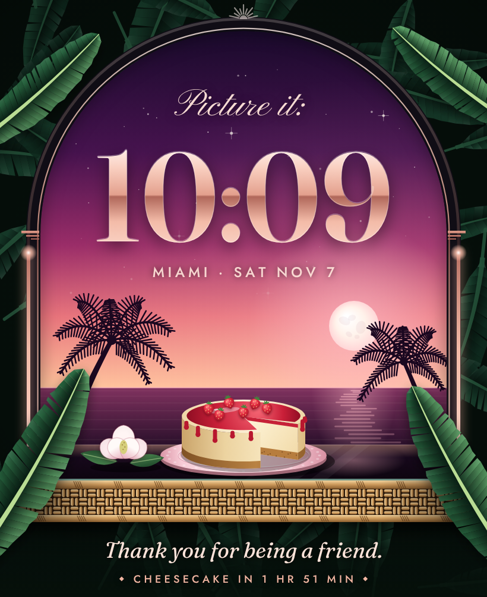

# Cheesecake O'Clock

A Golden Girls tribute watch face for Apple Watch Ultra (49 mm). It shows a late night on a Miami lanai: banana-leaf wallpaper, an arched window with deco trim, palms on the water, and a strawberry cheesecake on a glass-top wicker table.

There are four versions, one per girl:

| Girl | Scene | Metal | On the table | Line |
| --- | --- | --- | --- | --- |
| Blanche | Magnolia Night, full moon | rose gold | a magnolia | *Thank you for being a friend.* |
| Dorothy | Shady Pines, crescent moon | platinum | late-night coffee | *Shady Pines, Ma.* |
| Rose | St. Olaf Morning, sunrise | pearl | daisies from the farm | *Back in St. Olaf…* |
| Sophia | Sicily, 1922, sunset | gold | her wicker purse | *Picture it: Sicily, 1922.* |

## What's here

| Path | What it is |
| --- | --- |
| `wallpapers/ultra-and-ultra-2_410x502/` | Wallpapers for the watchOS Photos face, at the native size of Ultra and Ultra 2 |
| `wallpapers/ultra-3_422x514/` | The same wallpapers at the Ultra 3 size |
| `previews/` | The live concept at 2x, frozen at 10:09 |
| `index.html` | Showcase page: the live, animated face in a watch mockup, with a picker for the four girls |
| `face.js` | The canvas renderer used by the page and the exporter. Everything is drawn in code |
| `export.html`, `export.mjs` | Re-render the PNGs with `node export.mjs` (needs Playwright) |

## Putting it on the watch

1. Save the four PNGs from the folder that matches her watch to her iPhone's Photos, and add them to an album called Golden Girls.
2. Open the Watch app on the iPhone, go to Face Gallery, and tap Photos.
3. In the content options, choose the four photos (or the Golden Girls album).
4. Tap Add. A different girl appears each time she raises her wrist or taps the screen.

watchOS draws the time itself, in Apple's font, over the open sky at the top of each wallpaper. The animated parts of the design only run in the showcase page:

- "Picture it:" above the time, like the start of one of Sophia's stories.
- The arch trim works as a second hand. Two lines climb from both sides and meet at the keystone every minute.
- The bottom line counts down to midnight. From 12:00 to 12:59 AM it reads "It's cheesecake o'clock."

## Credits

This is a fan-made tribute for personal use and isn't affiliated with the show or its rights holders. It uses no photos, logos or artwork from the series. The fonts are Fraunces, Jost and Pinyon Script from Google Fonts (SIL Open Font License).
