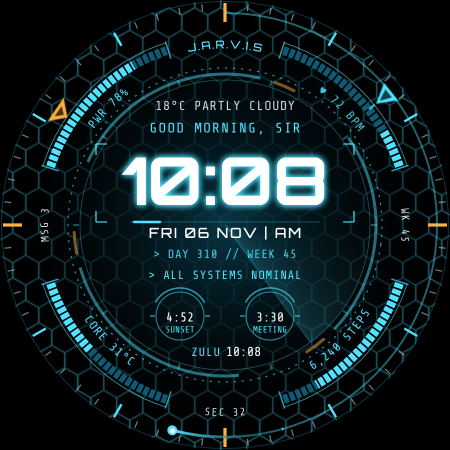

# J.A.R.V.I.S. HUD watch face

A fan-made, Iron Man–style heads-up display for **Galaxy Watch5 Pro** and **Galaxy Watch Ultra**
(any Wear OS 5+ watch works). It is built in Google's **Watch Face Format v2**, the format Samsung
and Google require for new watch faces, so there is no app code: the APK only holds the face.



**Install file:** [`release/JarvisHUD.apk`](release/JarvisHUD.apk) ·
**Live simulator:** open [`preview/index.html`](preview/index.html) in any browser.

## What's on it

| Ring | Details |
|---|---|
| Bezel | 60 minute ticks, gold cardinal markers, smooth seconds trail with a comet head, gold hour chevron and theme-colored minute chevron |
| Gauges | **PWR** battery (red at 15%, "breathes" while charging) · **♥ BPM** heart rate (label pulses at your measured heart rate) · **STEPS** toward your goal (gold when done) · **CORE** battery temperature in °C or °F (follows your weather unit) |
| Cardinals | `J.A.R.V.I.S` at 12 · week number at 3 · live seconds at 6 · unread messages at 9 |
| Reactor | Counter-rotating dashed and segmented rings, 10 coil notches, radar sweep, hex grid with tilt parallax |
| Core | Weather + condition · greeting that changes with the time of day ("Good evening, Sir", "Working late, Sir?") · glowing 12/24-hour clock · date · telemetry ticker cycling every 3 s (high/low, rain chance, UV, lunar phase, day/week, messages, step goal) · status line (charging, critical power, high heart rate, goal reached, or ALL SYSTEMS NOMINAL) |
| Pods | Two customizable complication slots (default: sunrise/sunset and next calendar event) that accept short text, ranged values, icons and images |
| Second zone | Zulu (UTC), Malibu, New York, London, Dubai, Tokyo or Sydney |
| Wake | A sonar "systems online" ping sweeps the face when it becomes visible, and again when you tap empty space |
| Always-on | Standby screen: time, date, chevrons, dim ticks, power level. Everything else switches off to save battery |

**Tap shortcuts:** battery gauge → battery · heart gauge → heart rate · time → alarms ·
date → calendar · status line → messages · core gauge → settings · `J.A.R.V.I.S` tag → music player.

**Customize** (long-press the face → Customize):

- **Suit / HUD color:** Arc Reactor, Mark III Hot Rod, War Machine, Stealth Mk XVI, Extremis, Rescue, Nano Red
- **Address me as:** Sir, Ma'am, Boss, Mr. Stark, or no title
- **Second time zone**
- **HUD animation:** turn off to stop the rotating rings, radar and smooth seconds (saves battery)
- **Hex grid + radar:** background on/off
- **Left pod / right pod:** any complication your watch offers

## Install on the watch

Requires One UI 6 Watch (Wear OS 5) or newer.

1. On the watch: **Settings → About watch → Software**, tap **Software version** 5 times.
2. **Settings → Developer options:** turn on **ADB debugging** and **Wireless debugging**, then tap **Pair new device**.
3. From a computer on the same Wi-Fi (Android platform-tools installed):
   ```
   adb pair <ip>:<pairing-port>      # enter the pairing code shown on the watch
   adb connect <ip>:<port>
   adb install JarvisHUD.apk
   ```
   No computer? Phone apps like *Bugjaeger* can install over the same wireless debugging connection.
4. Long-press the current watch face, swipe to **J.A.R.V.I.S. HUD**, tap it, then **Customize**.

If you later install a build signed with a different key, uninstall the old one first:
`adb uninstall com.jarvishud.watchface`.

## Build it yourself

Everything is generated from [`tools/generate.py`](tools/generate.py), so change the design there,
not in `watchface.xml`.

```bash
pip install pillow xmlschema
python3 tools/generate.py                       # writes res/raw/watchface.xml + PNGs + strings
python3 tools/validate.py <google/watchface checkout>   # official WFF v2 XSD + expression lint
python3 tools/build_preview.py                  # rebuilds preview/index.html
```

Then either:

- **Android Studio / Gradle:** open this folder and run `./gradlew :watchface:assembleDebug`, or
- **No SDK:** `sudo apt install aapt apksigner zipalign android-sdk-platform-23` and run
  `tools/build_apk.sh` (writes `release/JarvisHUD.apk`, creates a signing key on first run).

The XSD schema lives in [google/watchface](https://github.com/google/watchface)
(`third_party/wff/specification/documents/2`).

## How it was checked

- `watchface.xml` passes the official Watch Face Format **v2 XSD 1.1** schema, and all 143
  expressions pass a lint for unknown data sources, functions, argument counts and brackets.
- The simulator renders the same XML file that is packed in the APK (byte-identical).
- The APK was inspected with `aapt2` (WFF v2 property, `hasCode=false`, min SDK 34) and verified
  with `apksigner` and `zipalign -c` (uncompressed, aligned `resources.arsc`).
- Image memory: about 10.6 MB while active (limit 100 MB) and under 0.1 MB in always-on (limit 10 MB).
- Not yet run on a physical watch. Curved-text placement and glow strength may differ by a few pixels
  from the simulator.

## Files

```
tools/generate.py            design source: geometry, data bindings, themes, assets
tools/validate.py            XSD + expression checks
tools/build_preview.py       bundles the browser simulator
tools/build_apk.sh           Gradle-free APK build
preview/wff-renderer.js      small Watch Face Format renderer for the browser
watchface/src/main/          Android project (manifest, res/raw/watchface.xml, fonts, images)
release/JarvisHUD.apk        signed, ready to sideload
```

Fan-made tribute for personal use. Not affiliated with or endorsed by Marvel, Disney or Samsung;
don't publish it to a store under these names. Fonts: Orbitron and Share Tech Mono, SIL Open Font
License 1.1 (see `licenses/`).
