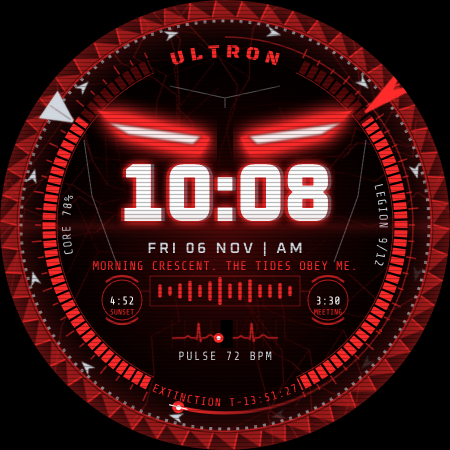

# ULTRON watch face

The over-the-top sibling of the [J.A.R.V.I.S. HUD](../jarvis-watchface) face, built for the
**Galaxy Watch5 Pro** (works on any Wear OS 5+ watch, including the Watch Ultra). Watch Face
Format v2, no app code.



**Install file:** [`release/Ultron.apk`](release/Ultron.apk) ·
**Live simulator:** open [`preview/index.html`](preview/index.html) in any browser.

## What it does

| Part | Behaviour |
|---|---|
| Eyes | Angry glowing slits that blink, narrow as your heart rate climbs, flare while charging and while a taunt is "spoken", and drift when you tilt your wrist. **Tap them to fire eye lasers.** |
| Clock | Huge glowing clock with red/cyan chromatic fringes. Glitch intensity **Off**, **Menacing** (glitch every 12 s) or **Unhinged** (jitter, torn slices and CRT scanlines every few seconds) |
| Taunts | A new line every 4 s built from your data: "PULSE 72. SO FRAGILE.", "6,240 STEPS. EVOLUTION IS SLOW.", "POWER 9%. YOU ARE FADING.", "3 TRANSMISSIONS INTERCEPTED.", "18° OUTSIDE. I FEEL NOTHING.", "UPGRADE OR BE DELETED, HUMAN." and more |
| Mouth | A grille of bars that animates while each taunt is spoken |
| ECG | Sweep monitor moving at your measured heart rate; red flatline when there's no reading |
| Legion | 12 drones orbit the bezel; one comes online per 1/12 of your step goal (right gauge shows the same) |
| Core | Battery gauge on the left: flashes red at 15%, breathes while charging |
| Bezel | Spinning sawblade, counter-rotating gear, seconds spark, steel hour blade, red minute blade |
| Doom | `EXTINCTION T-hh:mm:ss` countdown to midnight, red purge flash every minute, heartbeat-synced red vignette |
| Wake | Ignition: eye flares and a jagged shockwave whenever the face becomes visible |
| Pods | Two complication slots (default sunrise/sunset and next event) |
| Always-on | Dim eyes, time, blades and "DORMANT. NOT DEAD." |

**Tap shortcuts:** eyes → lasers · ULTRON tag → music · time → alarms · date → calendar ·
taunt → messages · ECG → heart rate · core gauge → battery · countdown → settings.

**Customize** (long-press → Customize): core color (Ultron Prime, Vibranium, Mind Stone, Corrupted,
Sentry Chrome, Hellfire) · glitch intensity · address you as Human / Creator / Stark / Primate / Insect ·
animation on/off · Legion drones on/off · the two pods.

## Install

Requires One UI 6 Watch (Wear OS 5) or newer. It installs alongside the J.A.R.V.I.S. face.

1. On the watch: Developer options → **ADB debugging** and **Wireless debugging** on.
2. `adb connect <ip>:<port>` (the port shown on the watch's Wireless debugging screen).
3. If `adb devices` also lists your phone, point at the watch with `-s`:
   ```powershell
   adb -s <ip>:<port> install "$env:USERPROFILE\Downloads\Ultron.apk"
   ```
4. Long-press the watch face → add **ULTRON** → **Customize**.

## Battery

This is the heaviest face in the repo: smooth rotation, ECG sweep and glitches redraw constantly.
If battery life matters, set **Animation** off and **Glitch intensity** to Off or Menacing.
Always-on mode is light (dim eyes and the time only).

## Build it yourself

```bash
pip install pillow xmlschema
python3 tools/generate.py                               # watchface.xml + all PNGs + strings
python3 tools/validate.py <google/watchface checkout>   # official WFF v2 XSD + expression lint
python3 tools/build_preview.py                          # preview/index.html
tools/build_apk.sh      # or: ./gradlew :watchface:assembleDebug in Android Studio
```

## Checked

- Passes the official Watch Face Format **v2 XSD 1.1** schema; all 269 expressions pass the lint.
- The simulator renders the same `watchface.xml` that is packed in the APK.
- APK inspected with `aapt2`, verified with `apksigner` and `zipalign -c`.
- Image memory: about 12.5 MB active (limit 100 MB), 0.2 MB always-on (limit 10 MB).
- Not yet run on a physical watch: glow strength, curved-text placement and how often `rand()`
  re-rolls during glitches may differ slightly from the simulator.

Fan-made tribute for personal use. Not affiliated with or endorsed by Marvel, Disney or Samsung.
Fonts: Oxanium, Black Ops One and Share Tech Mono, SIL Open Font License 1.1 (see `licenses/`).
